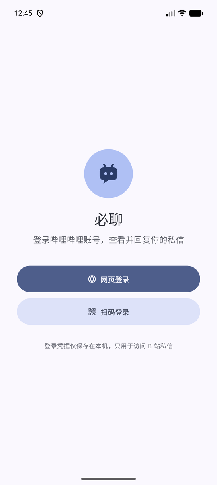
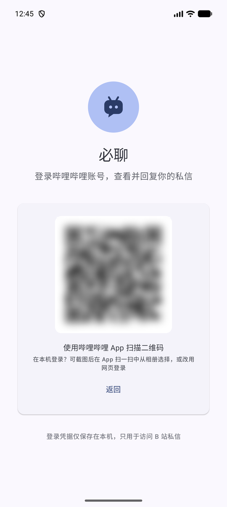
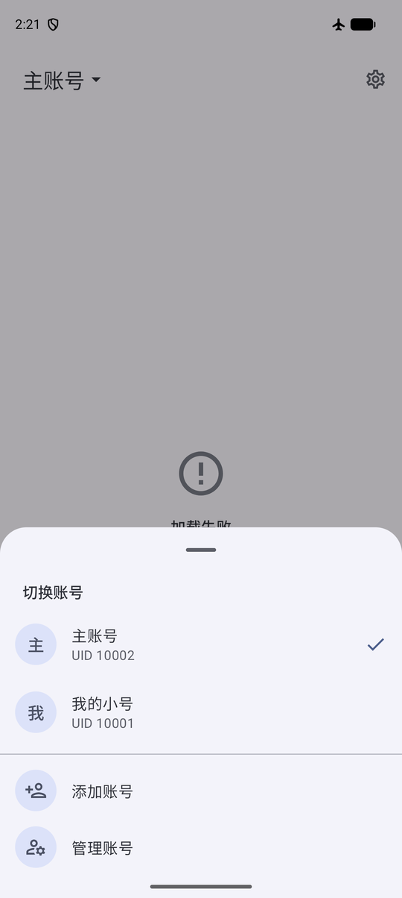
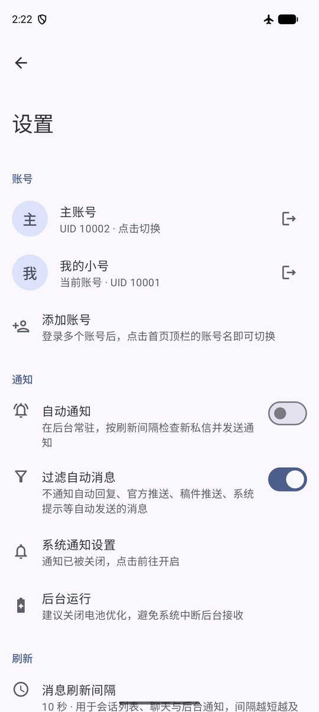

<div align="center">


# 必聊

**一个 Material You 风格的哔哩哔哩私信客户端**

只做一件事：好好收发 B 站私信。


</div>

> [!WARNING]
> 本项目为个人开发的**非官方**客户端，与哔哩哔哩（上海幻电信息科技有限公司）无任何关联。
> 使用的是 B 站 Web 端的非公开接口，接口随时可能变化导致功能失效；请自行评估账号风险后使用。

## 截图

| 登录 | 扫码登录 | 切换账号 | 设置 |
| :---: | :---: | :---: | :---: |
|  |  |  |  |

## 功能

- **原生 Material You 界面**：默认从壁纸提取主题色（Android 12+），不支持或关闭时使用 B 站粉配色；跟随系统深色模式
- **简洁布局**：没有底栏，顶栏显示当前账号昵称，右侧是设置
- **全部私信**：已关注、未关注、系统通知与粉丝团会话一览，显示置顶、免打扰与未读数，支持下拉刷新与翻页
- **完整聊天**
  - 显示文字、B 站表情、图片、分享 / 稿件推送 / 通知卡片、撤回提示，标出自动回复
  - 发送文字、**图片**（自动转换 HEIC/WebP 等格式）与**表情**（包括账号拥有的会员和装扮表情、颜文字）
  - 长按复制，2 分钟内可撤回自己的消息；图片可全屏缩放查看
- **多账号**：登录多个 B 站账号，点顶栏昵称随时切换；所有账号都能收到通知，通知里会注明是哪个账号的消息
- **自动通知**
  - **无需常驻后台**：用精确闹钟按刷新间隔唤醒检查，两次检查之间不占用后台；以系统“对话”通知展示，可在通知里**直接回复**或**标为已读**
  - **息屏时放慢**：息屏后一直没有新消息时，检查间隔逐步放慢到最多 5 分钟，收到消息、亮屏或打开必聊后恢复
  - **省电模式**：改由系统统一安排，约 15 分钟或更久检查一次，最省电但通知会明显延迟
  - 遵循你在 B 站设置的免打扰；正在查看的会话不打扰
  - 开启时不会把已有的未读一次性弹出来，只通知之后的新消息
- **过滤自动消息**：不通知自动回复、官方推送、稿件推送、系统提示、互关招呼等非真人发送的消息
- **自定义刷新间隔**：5 秒 ~ 10 分钟，同时作用于会话列表、聊天界面与后台通知

## 下载

在 [Releases](../../releases) 页面下载最新的 APK 安装即可（需要允许“安装未知来源应用”）。

## 使用说明

### 登录

| 方式 | 适合场景 |
| --- | --- |
| **网页登录** | 在本机登录。应用内打开 B 站官方登录页，由你自己输入账号或短信验证码，必聊只读取登录成功后的 Cookie |
| **扫码登录** | 手边有另一台已登录 B 站 App 的设备时，直接扫码确认 |

添加更多账号：点击首页顶栏的昵称 → **添加账号**，或在 **设置 → 账号** 中添加。

### 让通知更及时

1. 在 **设置 → 自动通知** 中开启，并允许通知权限
2. 在 **设置 → 后台运行** 中关闭电池优化
3. 部分国产系统（MIUI / HyperOS、ColorOS、OriginOS 等）还需要在系统设置中允许自启动、在多任务界面锁定必聊。这些系统上划掉应用可能等同于强行停止，会清除已安排的检查，直到下次打开必聊

> B 站不向第三方应用推送私信，所以必聊只能定时检查。它不常驻后台，而是用精确闹钟按刷新间隔唤醒自己检查一次，检查完就让系统休眠。关闭电池优化后，息屏进入 Doze 也能准时检查；否则系统每小时最多放行约 72 次。刷新间隔越短越及时，也越耗电，日常使用建议 10 ~ 30 秒。

## 构建

环境要求：JDK 17 及以上（开发时使用 JDK 21）、Android SDK Platform 37。克隆仓库后在根目录执行：

```bash
./gradlew :app:assembleDebug
```

Windows PowerShell：

```powershell
$env:JAVA_HOME = "C:\Program Files\Android\openjdk\jdk-21.0.8"
$env:ANDROID_HOME = "$env:LOCALAPPDATA\Android\Sdk"
.\gradlew.bat :app:assembleDebug
```

产物位于 `app/build/outputs/apk/debug/`。也可以直接用 Android Studio 打开项目根目录运行 `app`。

## 技术栈

| 类别 | 选型 |
| --- | --- |
| 语言 | Kotlin 2.4 |
| 界面 | Jetpack Compose、Material 3、Navigation Compose |
| 网络 | OkHttp 5、kotlinx.serialization（JSON 树解析，兼容超出 Long 范围的数字） |
| 图片 | Coil 3 |
| 二维码 | ZXing |
| 后台 | 精确闹钟（`setExactAndAllowWhileIdle`）逐次唤醒；省电模式用 JobScheduler 定期任务 |
| 最低版本 | Android 8.0（API 26），目标 API 37 |

## 项目结构

```
app/src/main/java/com/bilichat/app
├── data/                  # 数据层
│   ├── AccountStore.kt    # 多账号与 Cookie 持久化（含旧版单账号迁移）
│   ├── AccountManager.kt  # 登录、切换、退出、登录失效处理；每个账号一个 AccountSession
│   ├── ChatRepository.kt  # 单个账号的会话列表与消息，界面与后台服务共享
│   ├── ImagePreparer.kt   # 读取并按需转码待发送的图片
│   └── bili/              # B 站接口、WBI 签名、消息内容解析
├── domain/model/          # Account、Conversation、ChatMessage、MessageContent 等
├── notify/                # 后台检查调度（闹钟 / 定期任务）、新消息检查、会话通知与通知操作
└── ui/                    # 登录、会话列表、聊天、表情面板、设置
```

依赖注入为手写的 `AppContainer`，没有引入 DI 框架。

## 用到的接口

| 功能 | 接口 |
| --- | --- |
| 账号信息 / WBI 口令 | `api.bilibili.com/x/web-interface/nav` |
| 扫码登录 | `passport.bilibili.com/x/passport-login/web/qrcode/*` |
| 会话列表 | `api.vc.bilibili.com/session_svr/v1/session_svr/get_sessions` |
| 消息记录 | `api.vc.bilibili.com/svr_sync/v1/svr_sync/fetch_session_msgs` |
| 发送 / 撤回 | `api.vc.bilibili.com/web_im/v1/web_im/send_msg`（WBI 签名） |
| 设为已读 | `api.vc.bilibili.com/session_svr/v1/session_svr/update_ack` |
| 用户信息 | `api.bilibili.com/x/polymer/pc-electron/v1/user/cards` |
| 图片上传 | `api.bilibili.com/x/dynamic/feed/draw/upload_bfs` |
| 表情面板 | `api.bilibili.com/x/emote/user/panel/web` |

## 隐私与安全

- 登录 Cookie 只保存在应用私有目录，**不会上传到除 B 站以外的任何服务器**
- 已关闭系统备份，并在 Android 12+ 上排除了云备份与换机迁移，凭据不会被带到其他设备
- 退出账号时会调用 B 站的退出接口使会话失效，并清除本地数据
- 网页登录的账号密码由 B 站官方页面处理，必聊不读取、不保存

## 常见问题

**收不到通知？**
确认已开启“自动通知”并授予通知权限，关闭电池优化；国产系统还需允许自启动。开启“息屏时放慢”后，息屏且一直没有新消息时最多 5 分钟检查一次；开启“省电模式”后约 15 分钟以上才检查一次。

**发送失败，提示“对方主动回复或关注你前，最多发送1条消息”等？**
这是 B 站的限制，提示内容由 B 站返回，必聊无法绕过。

**某个账号自己消失了？**
B 站返回“账号未登录”时，必聊会移除该账号并发出提醒，重新登录即可。常见原因是在其他设备上修改了密码或退出了登录。

**有些消息显示“暂不支持的消息类型”？**
B 站的私信类型很多，少见类型请在哔哩哔哩 App 中查看，也欢迎提 Issue 附上样例。

## 致谢

- [SocialSisterYi/bilibili-API-collect](https://github.com/SocialSisterYi/bilibili-API-collect)：B 站接口文档整理（原仓库已停止维护，开发时参考的是社区镜像）
